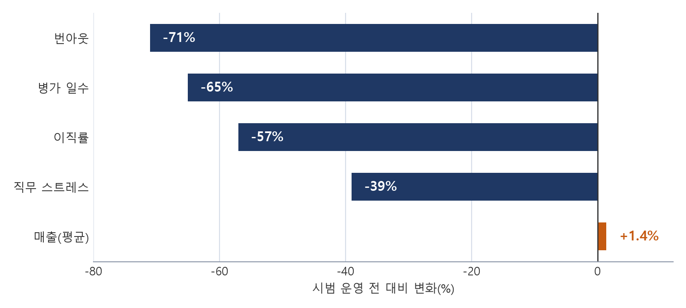

## 1. 서론

주 5일·40시간 근로 체제는 물리적 가동 시간과 생산량이 비례하던 산업화 시기에 정착한 규범이다. 지식 기반 경제로의 전환과 디지털 협업 도구의 확산, 코로나19 이후 보편화된 원격근무는 투입 시간과 성과 사이의 연동을 약화시켰다. 장시간 근로에 따른 피로와 번아웃은 인재 이탈과 몰입도 저하로 이어져 기업의 생산성을 위협하는 요인으로 지목된다.

이러한 배경에서 주 4일제는 근로시간 단축을 넘어 비효율적 업무 관행을 걷어내는 경영 전략으로 주목받고 있다. 이 글은 주요 시범 운영 사례의 성과와 실패 요인을 비교하고, 국내 도입 시 검토해야 할 법적 쟁점을 정리하는 것을 목적으로 한다.

## 2. 선행 사례와 분석 틀

### 2.1 주요 시범 운영 사례

영국에서는 2022년 하반기 4 Day Week Global과 오토노미(Autonomy), 케임브리지 대학교, 보스턴 칼리지 연구진이 61개 기업 약 2,900명을 대상으로 6개월간 시범사업을 진행하였다(Lewis et al., 2023). 실험은 급여 100%를 보전하고 근로시간을 80%로 줄이되 산출 100%를 유지하는 ‘100-80-100’ 모델[^1]로 설계되었다.

아이슬란드는 2015년부터 2019년까지 레이캬비크 시의회와 중앙정부 주도로 2,500여 명의 공공부문 노동자를 대상으로 주 40시간을 35~36시간으로 줄이는 실험을 운영하였다(Haraldsson & Kellam, 2021). 국내에서는 세브란스병원이 2023년 1월부터 교대근무 간호사를 대상으로 시범사업을 시작하였다.

<표 1> 주요 시범 운영 사례 비교

| 사례 | 규모·방식 | 주요 결과 |
|---|---|---|
| 영국 컨소시엄 | 61개사, 약 2,900명, 임금 보전 | 번아웃 -71%, 이직률 -57% |
| 아이슬란드 공공부문 | 약 2,500명, 주 35~36시간 | 서비스 품질 유지·개선 |
| 마이크로소프트 재팬 | 정규직 약 2,300명, 1개월 | 1인당 매출 +39.9% |
| 세브란스병원 | 교대제 간호사 병동 | 신규 간호사 퇴사율 19.5%→7.0% |

자료: Lewis et al.(2023), Haraldsson & Kellam(2021), Gemini 딥리서치 정리 자료

### 2.2 분석 틀

이 글은 각 사례의 성과를 생산성·재무, 구성원 웰빙, 인력 유지의 세 영역으로 나누어 비교하고, 철회 사례는 실패 요인을 업무 재설계 여부와 업종 특성으로 나누어 살펴본다.

## 3. 분석 결과

### 3.1 생산성과 재무 성과

영국 파일럿 참여 기업의 매출은 6개월 동안 평균 1.4% 상승하였다(Lewis et al., 2023). 마이크로소프트 재팬은 회의 시간을 30분으로 제한하고 비동기 협업을 강제한 결과 1인당 매출이 39.9% 상승하였다. 이 상승은 업무 절차를 바꾼 결과로 해석된다.

### 3.2 구성원 웰빙과 인력 유지

영국 파일럿에서 참여자의 71%가 번아웃 감소를 보고하였고 병가 일수는 65% 줄었다. 6개 국가 141개 조직 2,896명을 대조군 12개사와 비교한 연구에서도 번아웃, 직무 만족, 정신·신체 건강이 개선되었다(Fan et al., 2025). 세브란스병원에서는 입사 3년 미만 간호사의 퇴사율이 19.5%에서 7.0%로 낮아졌다.

### 3.3 철회 사례

에듀윌은 2019년 도입한 주 4일제를 2023년 폐지하였다. 주력 시장 축소라는 외부 충격 속에서 업무 효율화가 뒷받침되지 않았기 때문이다. 미국 O.C. 태너는 생산직 450명에게 1일 10시간 압축 근무를 적용하였으나 피로 누적과 설비·물류 불일치로 2개월 만에 중단하였다.

<표 2> 운영 유형별 특징

| 유형 | 근로시간 | 장점과 한계 |
|---|---|---|
| 순수 단축형 | 주 32시간 | 몰입도 향상 / 납기 지연 위험 |
| 시간 압축형 | 1일 10시간, 주 40시간 | 비용 증가 없음 / 피로 누적 |
| 순환 교대형 | 주 32시간, 요일 분산 | 대고객 연속성 / 협업 조율 |
| 격주·단계형 | 주 35~36시간 | 위험 최소화 / 체감 효과 작음 |

자료: Gemini 딥리서치 정리 자료

## 4. 국내 도입 시 법적 쟁점

임금을 유지한 채 소정근로시간을 주 32시간으로 줄이면 월 소정근로시간이 약 209시간에서 167시간으로 줄어 통상시급이 약 25% 오른다. 통상시급은 근로기준법 제56조의 연장·야간·휴일근로 가산수당 산정 기준이므로 단축 후 연장근로를 관리하지 않으면 인건비가 늘어난다[^2].

1일 10시간 압축 근무는 제51조의 탄력적 근로시간제나 제52조의 선택적 근로시간제 요건을 갖추어야 하며, 그렇지 않으면 1일 8시간을 넘는 2시간마다 가산수당이 발생한다. 일부 부서만 전환하면 해당 인원은 제18조의 단시간 근로자가 되어 연차휴가를 시간 단위로 비례 산정한다. 불리하게 해석될 여지가 있는 조항을 바꿀 때는 제94조에 따라 근로자 과반수의 서면 동의를 받아야 한다.

## 5. 결론

분석 결과 주 4일제의 성패는 근로시간의 길이보다 업무 절차를 다시 설계했는지와 업종의 특성에 따라 갈렸다. 지식서비스업은 회의·보고 절차를 줄여 성과를 유지하기 쉬운 반면, 설비 가동 시간이 생산량을 결정하는 제조업은 단순 압축 모델의 위험이 크다. 국내 기업은 3~6개월 단위 파일럿과 취업규칙 정비를 거쳐 단계적으로 도입하는 방식이 적절하다.

## 참고문헌

- 근로기준법. 국가법령정보센터.
- Fan, W., Schor, J. B., Kelly, O., & Gu, G. (2025). Work time reduction via a 4-day workweek finds improvements in workers' well-being. *Nature Human Behaviour*, 9(10). https://doi.org/10.1038/s41562-025-02259-6
- Haraldsson, G. D., & Kellam, J. (2021). *Going public: Iceland's journey to a shorter working week*. Alda & Autonomy.
- Lewis, K., Stronge, W., Kellam, J., & Kikuchi, L. (2023). *The results are in: The UK's four-day week pilot*. Autonomy.

[^0]: 이 원고는 hwp-tool의 논문 조판 예시로, Gemini 딥리서치 자료를 논문 형식으로 재구성한 것이다.
[^1]: 급여 100%, 근로시간 80%, 산출 100%를 뜻한다.
[^2]: 가산수당은 법정근로시간(1일 8시간, 1주 40시간)을 넘는 시점부터 발생하므로, 주 32~40시간 구간은 통상임금 100%만 지급해도 된다.
